# Solus Engineering Plan: Era-Adaptive 4K Anime Mastering (Retro Cel vs. Modern Digital) & Live Remote Shader Switching

## 1. Executive Summary & Root Cause Analysis

### 1.1 Why did 4K (`Ultra`) look "mushy / off" on *Serial Experiments Lain* while 2x (`Balanced`) looked good?

By inspecting the exact pixel math in [src/services/shaders.rs](file:///Users/abdullahbinmadhi/Projects/anime/src/services/shaders.rs), we identified **4 mathematical defects** in the `Ultra 4K` pipeline that specifically degraded 90s/early-2000s anime like *Serial Experiments Lain* (1998):

1. **Defect 1 — Double-Stacked Morphological Erosion (`Restore_CNN_VL` + `Restore_CNN_M`)**:
   In `build_shader_arg(Anime4KMode::Ultra)`, Solus ran `Restore_CNN_VL` **and then immediately ran** `Restore_CNN_M` on top of it! Running two morphological min/max pushes back-to-back erodes fine textures and turns 90s film grain and airbrushed shadows into **blotchy, oil-painted "mush"**.
2. **Defect 2 — Bilateral Pre-Blurring in `Clamp_Highlights` & `Upscale_CNN_x2_VL`**:
   - `Clamp_Highlights` blended 18% of the 4 neighboring pixels into the center pixel (`w_sum = 1.0 + ... * 0.18`).
   - `Upscale_CNN_x2_VL` blended another 18% of diagonal neighbors unconditionally (`mix(c.rgb, diag_dir, 0.18)`).
   - **Result**: The image was **blurred twice** before sharpening was even applied! `Balanced 2x` looked cleaner because it didn't double-stack the restore pass or over-push blurred pixels.
3. **Defect 3 — Independent RGB Channel Sharpening (Color Smearing)**:
   Sharpening `R`, `G`, and `B` independently (`vec3`) causes each color channel to hit min/max clamps at different rates, shifting hues and creating muddy edges around dark anime lines (especially noticeable on *Lain*'s red/green CRT glow and dark brown hair).
4. **Defect 4 — Valley Darkening on Film Grain (`min_all * 0.92` Overshoot)**:
   `Restore_CNN_VL` darkened every local luminance valley by up to 22% (`valley * 1.35`) and allowed clamping to overshoot below the neighborhood minimum (`min_all * 0.92`). On a 1998 cel anime with natural film grain and dithered shadows, every grain speck is a tiny luminance valley—amplifying grain blotches and crushing shadow detail.

---

### 1.2 Why did the Mobile Remote 4K Scaler Switcher do nothing when tapped?

Three issues prevented live shader switching from taking effect in the video player:

1. **`set_property` vs. `change-list` in mpv IPC**:
   In [src/services/remote.rs](file:///Users/abdullahbinmadhi/Projects/anime/src/services/remote.rs#L646-L648), Solus sent:
   ```json
   { "command": ["set_property", "glsl-shaders", "path1:path2"] }
   ```
   In mpv's runtime IPC engine, `glsl-shaders` is a **path-list option**. Modifying shaders live while a video is playing requires mpv's `change-list` command:
   - First clear active shaders: `["change-list", "glsl-shaders", "clr", ""]`
   - Then append each shader file individually: `["change-list", "glsl-shaders", "append", "/path/to/shader.glsl"]`
2. **IINA Missing `--mpv-input-ipc-server`**:
   In [src/api/player.rs](file:///Users/abdullahbinmadhi/Projects/anime/src/api/player.rs#L610-L640), when using IINA on macOS, `--mpv-input-ipc-server` was not passed, so IINA never opened the IPC socket for the remote to talk to.
3. **Era Context Missing in Remote State**:
   When switching shaders from the remote, `remote.rs` didn't know the currently playing anime's release year (`season_year`), so it couldn't select the era-adaptive shader preset.

---

## 2. Architecture: Era-Adaptive 2x & 4K Mastering Engine

Anime production history has two fundamentally different mastering eras. Because Solus already stores `anime.season_year` from AniList in SQLite ([src/db/cache.rs](file:///Users/abdullahbinmadhi/Projects/anime/src/db/cache.rs)), Solus can **automatically detect the anime's era** and tailor both `2x (Balanced)` and `4K (Ultra)` to the exact physics of how that anime was drawn!

```mermaid
flowchart TD
    A["Selected Anime (anime.season_year)"] --> B{"Era Detection"}
    
    B -->|"Year <= 2006 (e.g., Lain 1998, Bebop, NGE)"| C["EraProfile::RetroCel (Analog / 35mm Cel / Early Digipaint)"]
    B -->|"Year >= 2007 (e.g., Frieren, JJK, Edgerunners)"| D["EraProfile::ModernDigital (Digital Vector / HD Compositing)"]

    subgraph Retro_Pipeline ["Retro Cel Mastering (Zero Mush, Grain-Safe)"]
        C --> C1["2x Balanced: Luma-Only Catmull-Rom Bicubic + Noise-Gated Edge Crispness"]
        C --> C2["4K Ultra: 12-Tap Lanczos/Spline Luma Reconstruction + Sub-Pixel Anti-Aliasing + Strict [min,max] Clamp"]
    end

    subgraph Modern_Pipeline ["Modern Digital Mastering (Razor-Sharp Vector Lines)"]
        D --> D1["2x Balanced: Sobel Line Thinning + 2x Directional Edge-Guided Upscale"]
        D --> D2["4K Ultra: Precision Luma Line Reconstruction + 2x FidelityFX CAS + 16-bit Deband"]
    end

    style Retro_Pipeline fill:#2b1d0e,stroke:#ffaa44,stroke-width:2px
    style Modern_Pipeline fill:#0e1d2b,stroke:#44aaff,stroke-width:2px
```



### 2.1 How `EraProfile::RetroCel` (`season_year <= 2006`) Works
Designed specifically for 80s, 90s, and early-2000s anime (*Serial Experiments Lain*, *Neon Genesis Evangelion*, *Cowboy Bebop*, *Berserk*, *Monster*):
- **Quirk 1 — Film Grain & Halftone Dithering**:
  - **Solution**: Introduce a **Noise-Floor Edge Gate (`smoothstep(0.045, 0.14, grad)`)**. Any micro-texture with gradient $< 0.045$ (film grain, shadow dithering, subtle CRT glow) is **100% untouched**—never blurred into mush and never over-sharpened into noise!
- **Quirk 2 — Organic Hand-Painted Acetate Ink Lines**:
  - **Solution**: Instead of morphological min/max erosion (which makes hand-painted lines look blocky or blotchy), use **Pure Luminance ($Y$) Unsharp Deconvolution + Bicubic Catmull-Rom 2x Reconstruction**.
- **Quirk 3 — Color Bleeding & Hue Shifts**:
  - **Solution**: All sharpening is computed **strictly in Luminance ($Y$)** and added equally (`c.rgb + vec3(luma_delta)`), preserving 100% of the original cel paint colors and CRT glow without color fringing.
- **Quirk 4 — Zero Overshoot / Zero Jaggies**:
  - **Solution**: Strict neighborhood clamping `clamp(result, min_cross, max_cross)` with zero overshoot (`1.0`, never `0.92`) and directional coherence weighting so diagonal lines are silky smooth.

### 2.2 How `EraProfile::ModernDigital` (`season_year >= 2007`) Works
Designed for modern digitallyinked and composited anime (*Frieren*, *Demon Slayer*, *Solo Leveling*, *Attack on Titan*):
- **Quirk 1 — 720p/900p Studio Production Blur**:
  - **Solution**: Clean **Single-Pass Sobel Luma Line Thinning** that tightens soft 1080p broadcast lines into crisp native-4K contours (never double-stacked!).
- **Quirk 2 — Pure Luma FidelityFX CAS (No Pre-Blur)**:
  - **Solution**: Removes the old bilateral pre-blur and diagonal pre-blur. Uses a true **2x Sub-Pixel Edge-Guided Upscaler + Luma-Only Contrast Adaptive Sharpening (CAS)** that enhances fine digital background art and lighting with zero mushiness.

---

## 3. Live Remote 4K Switcher Fix (`change-list` IPC Protocol)

### 3.1 Multi-Step Atomic Shader Hot-Swap in [src/services/remote.rs](file:///Users/abdullahbinmadhi/Projects/anime/src/services/remote.rs)
When you tap **Off**, **Balanced 2x**, or **Ultra 4K** on your phone:
1. Solus looks up the active show's `season_year` from `RemotePlaybackState` and resolves the `AnimeEra` (`RetroCel` vs `ModernDigital`).
2. Solus sends mpv's native runtime shader list commands over IPC:
   ```json
   {"command": ["change-list", "glsl-shaders", "clr", ""]}
   ```
   Followed by appending each shader in the active profile:
   ```json
   {"command": ["change-list", "glsl-shaders", "append", "/path/to/shader1.glsl"]}
   {"command": ["change-list", "glsl-shaders", "append", "/path/to/shader2.glsl"]}
   ```
3. Solus dynamically updates mpv's scaler and deband properties at runtime:
   - `scale` $\rightarrow$ `"ewa_lanczossharp"` (or `"spline36"` when Off)
   - `deband` $\rightarrow$ `"yes"` (tuned to era) or `"no"` when Off
4. Solus displays a rich OSD confirmation banner directly inside the video window:
   - On *Serial Experiments Lain* (1998):
     `✦ Anime4K: ULTRA 4K [Retro Cel 1998 Profile — Grain-Safe Luma Mastering]`
   - On *Frieren* (2023):
     `✦ Anime4K: ULTRA 4K [Modern Digital 2023 Profile — Sobel Line Reconstruction + CAS]`

### 3.2 Enabling Live IPC for IINA on macOS
In [src/api/player.rs](file:///Users/abdullahbinmadhi/Projects/anime/src/api/player.rs), pass `--mpv-input-ipc-server=<socket>` to `iina-cli` so IINA exposes the exact same live IPC socket as `mpv`.

---

## 4. Implementation Roadmap

1. **[src/services/shaders.rs](file:///Users/abdullahbinmadhi/Projects/anime/src/services/shaders.rs)**:
   - Add `AnimeEra` enum (`RetroCel`, `ModernDigital`) with `AnimeEra::from_year(season_year: Option<i64>)`.
   - Remove all pre-blurring and double-stacked morphological passes.
   - Implement **Pure-Luminance ($Y$)** shaders for both `RetroCel` (noise-gated, grain-safe, zero-mush Catmull-Rom + Luma Deconvolution) and `ModernDigital` (single-pass Sobel Line Thinning + Sub-Pixel Directional 2x + Luma CAS).
   - Add `build_shader_list(mode: Anime4KMode, year: Option<i64>) -> Vec<String>` so `remote.rs` can append shaders individually via `change-list`.
2. **[src/services/remote.rs](file:///Users/abdullahbinmadhi/Projects/anime/src/services/remote.rs)**:
   - Add `season_year: Option<i64>` to `RemotePlaybackState`.
   - Update `"set_anime4k"` handler to use `["change-list", "glsl-shaders", "clr", ""]` and `["change-list", "glsl-shaders", "append", path]`, plus live `scale`, `cscale`, and `deband` property updates and Era-aware OSD notification.
   - Show the detected Era badge (`RETRO CEL` vs `MODERN HD`) right inside the Mobile Remote UI!
3. **[src/api/player.rs](file:///Users/abdullahbinmadhi/Projects/anime/src/api/player.rs)** & **[src/main.rs](file:///Users/abdullahbinmadhi/Projects/anime/src/main.rs)**:
   - Pass `anime.season_year` when building shaders and initializing `RemotePlaybackState`.
   - Enable `--mpv-input-ipc-server` for IINA so live remote switching works on both mpv and IINA.

---

## 5. Viewing in Neovim

```bash
nvim docs/ADAPTIVE_ERA_4K_UPSCALING_AND_LIVE_REMOTE_PLAN.md
```
