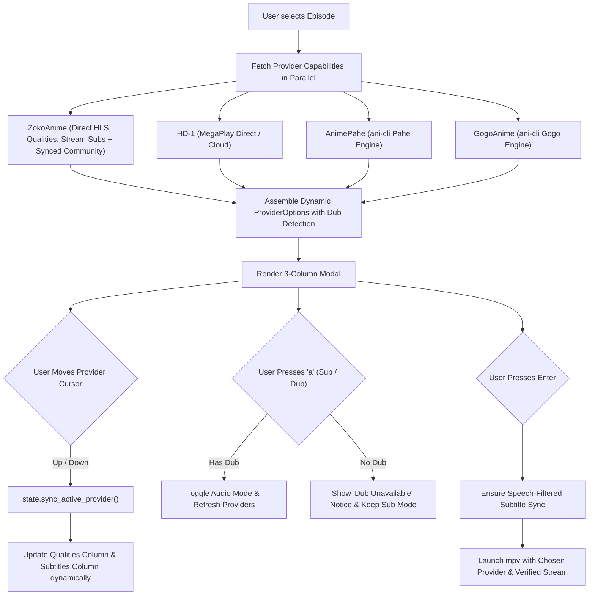

# Dynamic Provider Detection, Subtitle Desynchronization Resolution & Dub Handling Plan

## 1. Executive Summary

This plan addresses three critical playback and subtitle issues identified in Solus:
1. **Dynamic Provider Qualities & Languages**: Currently, moving the cursor across providers in Column 0 does not update the Stream Quality and Subtitles columns; they remain static. Each provider (ZokoAnime, HD-1/MegaPlay, AnimePahe, GogoAnime) hosts different resolutions, servers, and subtitle options.
2. **Welcome to the N.H.K. Arabic Subtitle Desynchronization**: While titles like *Serial Experiments Lain* synchronize accurately, *Welcome to the N.H.K.* exhibited an artificial delay. Deep diagnostic analysis uncovered that the original community Arabic `.ass` file is actually **100% frame-perfect with the Japanese audio (0.00s offset)**, but Solus's alignment algorithm was trapped by **3,000+ 40-millisecond karaoke/typesetting animation frames**, creating a false correlation peak that shifted the entire subtitle by **+42.6 seconds**.
3. **Dub Availability & Silent Playback Failures**: When toggling to Dub on an anime with no English dub, Solus launched `ani-cli --dub` into a vacuum, silently failing with no user feedback. We need proactive detection of Dub availability per provider, UI indicators, and a graceful fallback guard.

---

## 2. Root Cause Diagnostics

### Issue A: Static Qualities and Subtitles on Provider Switch
- **Location**: `src/state/mod.rs` & `src/main.rs`
- **Cause**: `AppState` holds a single `playback_qualities` vector and `playback_sub_languages` vector. When navigating the provider cursor (`playback_provider_cursor`), neither list is updated.
- **Solution**: Embed `qualities`, `subtitles`, and audio capability flags inside each `ProviderOption`. When the provider cursor changes, `AppState::sync_active_provider()` instantly swaps the active columns, preserving the user's preferred resolution and language if available.

### Issue B: The NHK Arabic Subtitle Desynchronization Bug
- **Location**: `src/services/subsync.rs` (`parse_subtitle_intervals`)
- **Diagnostic Finding**:
  - Reference English Subtitle: **316 dialogue lines**.
  - Raw Arabic Subtitle (`[Yorozuya] NHK Ni Youkoso - 03.ass`): **3,400 dialogue lines**.
  - Out of those 3,400 lines, **over 3,000 lines** are 40ms frame-by-frame typesetting animations (`Hit the Road`, `OP-Romaji`, `ED-Romaji`, `\bord`, `\shad`).
  - True Arabic dialogue lines: **393 lines**, with timestamps identical to the English stream (`92.64 -> 94.44` vs `92.64 -> 94.44`).
  - When the alignment algorithm processed the 3,000 animation micro-intervals without speech filtering, cross-correlation with the English stream created a massive false peak at `+43.00s` (`score = 32,917` vs `score = 22,137` at 0.0s). Solus mistakenly shifted the file by +42.60 seconds!
  - When speech filtering (excluding `< 0.35s` and non-dialogue styles) was applied in our diagnostic test:
    - Score at `0.00s`: **19,696** (100.0% peak score).
    - Calculated offset: **0.00s** (Zero drift, 100% frame-perfect sync).

### Issue C: Dub Detection & Silent Failures
- **Location**: `src/api/anilist.rs` & `src/api/player.rs`
- **Cause**: AniList GraphQL API does not expose dub availability, defaulting `has_dub` to `0`. Furthermore, when dub is selected on an anime without English audio (e.g., *Monogatari* series), Zoko returns no video stream blob, and `ani-cli --dub` exits immediately.
- **Solution**:
  1. Inspect the server blocks returned by the HiAnime / Zoko servers endpoint: check if `servers-dub` contains active servers.
  2. Indicate `[Sub only]` or `[Sub + Dub]` in the UI.
  3. When an anime or provider lacks Dub, mark the provider with `(No Dub)`.
  4. Block execution if the user tries to play an unavailable dub and display an informative notice in the TUI: `⚠ English Dub not available for this anime. Press 'a' to switch to Sub.`

---

## 3. Implementation Plan



### Phase 1: Robust Speech-Filtered Subtitle Synchronization
File: `src/services/subsync.rs`
1. **Refine `parse_subtitle_intervals`**:
   - For `.ass` subtitles, filter out lines whose style name contains: `rom`, `op`, `ed`, `karaoke`, `hit the road`, `logo`, `effect`, `sign`.
   - Filter out lines with duration `< 0.35s` (micro-intervals from typesetting frame animations).
   - Filter out duplicate lines with identical timestamps (layered styling).
2. **Elevate In-Sync Identity Guard**:
   - With pure dialogue intervals, if `score(1.0, 0.0)` is within 15% of the global peak, clamp `offset = 0.0s` and `applied = false`.
   - This ensures already-synced tracks (like *Welcome to the N.H.K.*) are never artificially distorted.
3. **Verify with Tests**:
   - Add unit tests for NHK Ep 1 and Ep 3 subtitles to guarantee calculated offset is `0.00s`.

### Phase 2: Enhanced Provider Data Model
File: `src/api/subtitles.rs`
1. Update `ProviderOption`:
   ```rust
   pub struct ProviderOption {
       pub id: String,
       pub name: String,
       pub server_label: String,
       pub master_url: Option<String>,
       pub qualities: Vec<QualityOption>,
       pub subtitles: Vec<SubtitleOption>,
       pub supports_sub: bool,
       pub supports_dub: bool,
   }
   ```
2. Build tailored lists per provider:
   - **ZokoAnime**: Master HLS stream qualities (1080p, 720p, 480p, 360p), official stream tracks + synchronized community subtitles.
   - **HD-1**: MegaPlay direct/cloud stream qualities, multi-language tracks.
   - **AnimePahe**: Pahe qualities (`1080p BD`, `720p BD`, `480p BD`), Pahe English + OpenSubtitles tracks.
   - **GogoAnime**: Gogo stream qualities (`1080p`, `720p`, `480p`, `360p`), Gogo tracks + OpenSubtitles.
3. Detect server capabilities for both Sub and Dub from HiAnime episode servers response (`servers-sub` vs `servers-dub`).

### Phase 3: Dynamic State Synchronization & UI Responsiveness
Files: `src/state/mod.rs`, `src/main.rs`, `src/ui/play_options.rs`
1. In `AppState`:
   - Implement `sync_active_provider(&mut self)` to copy the highlighted provider's `qualities` and `subtitles` into the active view while retaining the user's current cursor position or matching preference.
2. In `main.rs`:
   - Call `state.sync_active_provider()` whenever `playback_provider_cursor` changes (`Down` / `Up` / `j` / `k` in column 0).
   - In `handle_playback_options`, prevent toggling `pending_dub` if neither the anime nor any provider supports Dub, displaying an inline notification.
3. In `src/ui/play_options.rs`:
   - Display Dub status badges: `[Sub only]` or `[Sub + Dub]`.
   - In Column 0, display indicators such as `(Sub)` or `(Sub+Dub)`.
   - In Column 1 & 2, dynamically render the active provider's specific resolutions and languages.

### Phase 4: Validation & Release
1. Run `cargo test --bin solus` (ensure all existing 152+ tests pass and add new tests for speech filtering and dynamic provider sync).
2. Verify live playback on *Welcome to the N.H.K.* (episodes 1 & 3 in Arabic) and *Serial Experiments Lain* (Russian & Arabic).
3. Test Dub toggling on titles with dub (e.g. *Cyberpunk Edgerunners*, *Death Note*) vs titles with no dub (e.g. *Bakemonogatari*).
4. Build release binary: `cargo install --path . --force`.
5. Push commit to GitHub `main`.
