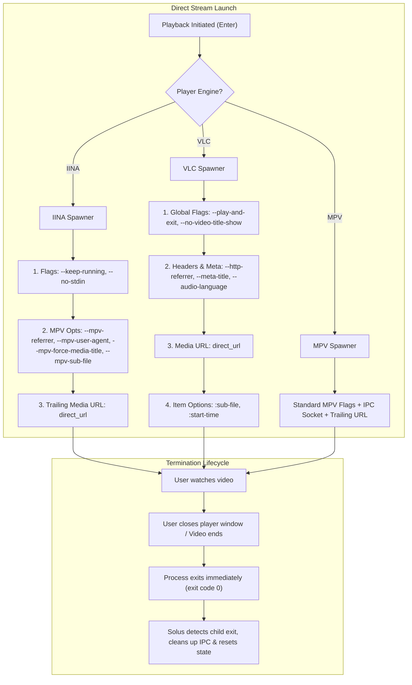

# IINA & VLC Playback Refinement Plan

## 1. Problem Statement

### 1.1 IINA: "Cannot open file or stream"
When launching video playback with **IINA** on macOS, IINA opens an alert dialog stating:
> *"Cannot open file or stream"*

#### Root Causes Identified:
1. **CLI Argument Ordering**:
   `iina-cli`'s argument specification defines:
   ```
   Usage: iina-cli [arguments] [files] [-- mpv_option [...]]
   ```
   In [src/api/player.rs](file:///Users/abdullahbinmadhi/Projects/anime/src/api/player.rs#L569-L573), the stream URL was passed as the second argument, *before* `--mpv-referrer=https://zokoanime.video/`:
   ```rust
   cmd.arg("--keep-running");
   cmd.arg(direct_url); // Passed BEFORE referrer!
   cmd.arg(format!("--mpv-force-media-title={} Episode {}", opts.title, opts.episode));
   cmd.arg("--mpv-referrer=https://zokoanime.video/");
   ```
   When `direct_url` is passed before `--mpv-referrer`, `iina-cli` dispatches the media URL to the player core before registering the Referer option. The HLS CDN returns **HTTP 403 Forbidden** (as verified with `curl`), causing IINA's "Cannot open file or stream" alert.
2. **Wrapper Script Argument Mangling**:
   In `solus-player-wrapper`, flags like `--no-stdin` (injected by ani-cli for IINA) were blindly prefixed with `--mpv-`, resulting in `--mpv-no-stdin`, which is rejected as an invalid option. Additionally, passing `--mpv-input-ipc-server` causes conflicts because IINA manages its own internal IPC bridge.
3. **Missing User-Agent Header**:
   Some CDNs require a standard browser User-Agent in addition to the Referer header to serve HLS chunks without 403 rejections.

---

### 1.2 VLC: Window Persistence & Immediate Auto-Play
When launching playback with **VLC**:
- VLC should immediately start playing the stream without showing playlist queues or dialogs.
- When the user closes the video window or stops playback, VLC should immediately terminate and return control to Solus, exactly matching MPV's clean single-instance lifecycle.

#### Root Causes Identified:
1. **Missing `--play-and-exit`**:
   In [src/api/player.rs](file:///Users/abdullahbinmadhi/Projects/anime/src/api/player.rs#L550-L566), VLC was launched without `--play-and-exit`. By default, VLC's GUI remains open indefinitely with an empty playlist window after playback ends or is stopped.
2. **VLC Argument Structure**:
   In VLC CLI syntax:
   - Global options (`--play-and-exit`, `--no-video-title-show`, `--meta-title=...`, `--http-referrer=...`, `--audio-language=...`) must precede the media item.
   - Item-specific stream options (`:sub-file=...`, `:start-time=...`) must follow the media item.
   In current code, `cmd.arg(direct_url)` was passed first, causing global options like `--meta-title` to be parsed as secondary playlist items or ignored.
3. **Wrapper Script VLC Defaults**:
   In `solus-player-wrapper`, `--play-and-exit` was only passed if ani-cli supplied it. It must be unconditionally enforced for all VLC launches.

---

## 2. Technical Architecture & Solution



---

## 3. Implementation Steps

### Step 1: Update IINA Direct Stream Command (`src/api/player.rs`)
Reorder arguments so all configuration and MPV options precede the media URL:
```rust
// 1. IINA CLI arguments
cmd.arg("--keep-running");
cmd.arg("--no-stdin");

// 2. MPV options (Headers, Metadata, Subtitles, Audio)
cmd.arg("--mpv-referrer=https://zokoanime.video/");
cmd.arg("--mpv-user-agent=Mozilla/5.0 (Macintosh; Intel Mac OS X 10_15_7) AppleWebKit/537.36 (KHTML, like Gecko) Chrome/120.0.0.0 Safari/537.36");
cmd.arg(format!("--mpv-force-media-title={} Episode {}", opts.title, opts.episode));

if opts.dub {
    cmd.arg("--mpv-alang=en,eng,English");
} else {
    cmd.arg("--mpv-alang=ja,jpn,Japanese");
}

if let Some(pos) = opts.start_pos {
    cmd.arg(format!("--mpv-start={}", pos));
}

if let Some(ref url) = opts.sub_url {
    if !url.is_empty() {
        cmd.arg(format!("--mpv-sub-file={}", url));
        cmd.arg("--mpv-sub-visibility=yes");
    }
}

if let Some(ref shaders) = opts.glsl_shaders {
    cmd.arg(format!("--mpv-glsl-shaders={}", shaders));
}

if let Some(ref style) = opts.sub_style {
    for flag in style.to_mpv_flags() {
        cmd.arg(format!("--mpv-{}", flag.trim_start_matches("--")));
    }
}

// 3. Trailing Media URL strictly at the end
cmd.arg(direct_url);
```

### Step 2: Update VLC Direct Stream Command (`src/api/player.rs`)
Structure VLC invocation with `--play-and-exit`, `--no-video-title-show`, and proper option precedence:
```rust
// 1. Global Lifecycle & Interface Flags
cmd.arg("--play-and-exit");
cmd.arg("--no-video-title-show");
cmd.arg(format!("--meta-title={} Episode {}", opts.title, opts.episode));

// 2. Network & Header Options
cmd.arg("--http-referrer=https://zokoanime.video/");
cmd.arg("--http-user-agent=Mozilla/5.0 (Windows NT 10.0; Win64; x64) AppleWebKit/537.36 (KHTML, like Gecko) Chrome/120.0.0.0 Safari/537.36");

if opts.dub {
    cmd.arg("--audio-language=en,eng");
} else {
    cmd.arg("--audio-language=ja,jpn");
}

// 3. Media URL
cmd.arg(direct_url);

// 4. Item-Specific Options (applied to the preceding URL)
if let Some(ref url) = opts.sub_url {
    if !url.is_empty() {
        cmd.arg(format!(":sub-file={}", url));
    }
}

if let Some(pos) = opts.start_pos {
    cmd.arg(format!(":start-time={}", pos));
}
```

### Step 3: Refine `solus-player-wrapper` for Ani-CLI Execution
Update the embedded bash wrapper script in [src/api/player.rs](file:///Users/abdullahbinmadhi/Projects/anime/src/api/player.rs#L445-L489):
- **VLC Branch**:
  - Always enforce `vlc_args=("--play-and-exit" "--no-video-title-show")`.
  - Filter `--input-terminal=*`, `--input-ipc-server=*`, `--sub-files-clr`, `--sub-auto=*`.
  - Map `--referrer=*` to `--http-referrer=*`.
  - Map `--sub-file=*` to `:sub-file=*`.
  - Place `"$video_link"` and `:item-options` at the end.
- **IINA Branch**:
  - Prepend `--keep-running` and `--no-stdin`.
  - Do NOT pass `--mpv-input-ipc-server` (IINA does not support mpv unix sockets).
  - Do NOT prefix `--no-stdin` or `--keep-running` with `--mpv-`.
  - Ensure `"$video_link"` is passed as the final argument after all `--mpv-*` options.

### Step 4: Verification & Testing
1. Unit tests:
   - `test_resolve_player_keeps_vlc`
   - `test_ensure_player_wrapper_creates_executable_wrapper`
   - Add unit tests for IINA argument ordering and VLC `--play-and-exit` flag generation.
2. CLI verification:
   - Launch real stream via IINA with updated argument order; verify zero alert popups and smooth playback.
   - Launch real stream via VLC with `--play-and-exit`; verify immediate playback, and that closing VLC exits the process cleanly.

---

## 4. Summary of Deliverables

| Player | Changes | Expected Outcome |
| :--- | :--- | :--- |
| **IINA** | Trailing URL placement, `--no-stdin` protection, omit invalid IPC sockets, add user-agent & valid `--mpv-sub-file` | Stream plays immediately; "Cannot open file" dialog is permanently eliminated |
| **VLC** | Add `--play-and-exit`, `--no-video-title-show`, global flags before URL, `:sub-file` and `:start-time` after URL | Starts playback immediately without prompt; quits completely when video window is closed |
